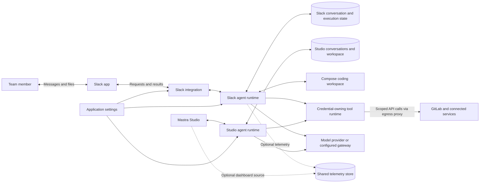

# Support Agent

An AI assistant for Slack that helps teams find information, understand code,
and turn requests into tested changes and GitLab merge requests. Conversations,
questions and results stay in the Slack thread where the work began.

Slack and Studio run the same Mastra agent definition in separate runtimes. It can:

- **Answer:** ask questions, explore repositories, and look up information through
  connected services without changing code.
- **Coding:** work in an isolated workspace, edit files, run project checks, and
  publish verified changes to GitLab for review.

Available tools and actions depend on the channel's configuration and your
permissions. Connected services include GitLab, Jira, Confluence, Datadog,
Cloudflare and Slack, with optional web search and page fetching.

## Using the bot

Mention the bot in an enabled Slack channel with a specific request. For example:

> @Support Agent Explain how authentication works in this repository.
>
> @Support Agent Fix the date formatting bug, add a regression test, and open a merge request.
>
> @Support Agent Summarize this CSV and return the results as a file.

Continue the conversation in the same thread to retain context. When automatic
thread replies are enabled, follow-up requests do not need another mention.
The bot shows a working indication and may ask a question before continuing.
You can [attach files or request an export](docs/slack-files.md).

Use `@Support Agent status` to inspect the current request, `@Support Agent cancel` to
stop it, or `@Support Agent continue <your answer>` to answer an outstanding question.
Code changes are delivered as merge requests for human review.

## Architecture

Mastra manages agent execution, tools and conversation memory. The application
checks access to channels, repositories and files, keeps service credentials out
of model context, and verifies publication and delivery outcomes. Network access
is restricted through configured egress controls.

## Further reading

- **Set up an instance:** [Slack app setup](docs/slack-app-setup.md),
  [GitLab](docs/gitlab.md),
  [deployment and configuration](docs/native-answer.md), and
  [access control](docs/authorization.md).
- **Operate the app:** [application settings](docs/application-settings.md),
  [deployment and recovery](docs/production-recovery.md), and
  [backup and restore](docs/native-answer.md#quiesced-logical-backup-and-fresh-restore).
- **Explore or test it:** [Mastra Studio](docs/mastra-studio.md),
  [testing](docs/testing.md) and the
  [live test setup runbook](docs/live-test-setup.md).
- **Contribute:** Follow the [development guide](docs/development.md).
